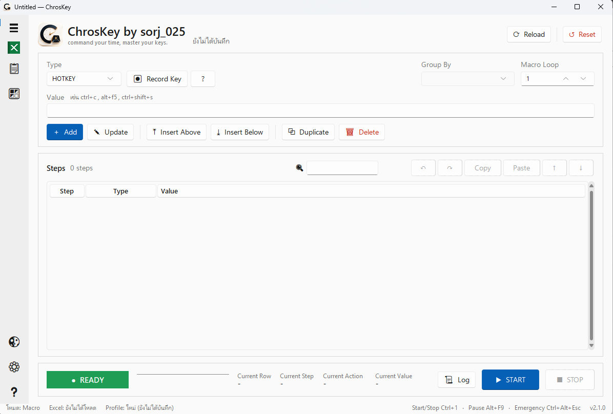

  

<h1 align="center">ChrosKey</h1>

<b>by sorj_025</b> · <i>command your time, master your keys.</i>

  โปรแกรมที่จะช่วยทำงานซ้ำ ๆ ผ่านคีย์บอร์ดและเมาส์ให้อัตโนมัติ — โดยไม่ต้องเขียนโค้ด

  
   หน้าหลัก — สร้างรายการ Step ด้านบน ดูและจัดลำดับด้านล่าง กด START เพื่อรัน

---

## เกี่ยวกับโปรแกรม

**ChrosKey** บันทึกขั้นตอนการทำงานเป็นรายการ (Step) แล้วรันซ้ำให้เอง: กดคีย์/ปุ่มลัด พิมพ์ข้อความ คลิกตำแหน่งบนจอ รอเวลา
และดึงข้อมูลจากไฟล์ Excel ไปกรอกลงโปรแกรมบัญชีหรือระบบใดก็ได้ที่เปิดอยู่บนเครื่อง
เหมาะกับงานคีย์ข้อมูลจำนวนมาก งานที่ต้องกดลำดับเดิมซ้ำ ๆ และงานที่ต้องมีคนเฝ้าหน้าจอ

## ความสามารถหลัก

| | |
|---|---|
| **Step หลายชนิด** | `HOTKEY` `KEY` `TEXT` `EXCEL` `CLICK` `DOUBLE_CLICK` `RIGHT_CLICK` `WAIT` `COMMENT` `LOOP_START` `LOOP_END` |
| **โหมด Excel** | โหลดไฟล์ .xlsx แล้วจัดกลุ่มเอกสาร (Group By) วนกรอกทีละรายการ มีไฮไลต์แถวที่กำลังทำ |
| **Popup Rules** | ตรวจจับหน้าต่างเด้งที่ไม่คาดคิด (เช่น "Save your changes?") แล้วกดปิดให้เองระหว่างรัน |
| **ตรวจสอบก่อนรัน** | บอกแถวที่ผิด เช่น WAIT ไม่ใช่ตัวเลข พิกัดผิดรูปแบบ ไม่พบคอลัมน์ Excel |
| **ปุ่มลัดทั่วเครื่อง** | Start/Stop · Pause · Emergency Stop ใช้ได้แม้ไม่ได้อยู่หน้าต่างโปรแกรม ตั้งเองได้ |
| **แก้ไขสะดวก** | Undo/Redo · คัดลอก/วาง/ตัด Step · ลากจัดลำดับ · ค้นหา · ทำสำเนา |
| **โปรไฟล์** | บันทึก/เปิดไฟล์ macro (.json) มีรายการที่เปิดล่าสุด |
| **ธีม** | สว่าง/มืด สไตล์ Windows 11 |
| **อัปเดตตัวเอง** | ตรวจเวอร์ชันใหม่ ดาวน์โหลด ตรวจ SHA-256 ติดตั้งทับให้อัตโนมัติ ข้อมูลเดิมไม่หาย |

## ติดตั้ง

1. รับลิงก์ตัวติดตั้ง `ChrosKey-Setup-x.y.z.exe` (Google Drive) จากผู้พัฒนา แล้วดาวน์โหลด
2. ดับเบิลคลิกแล้วกด Next (ไม่ต้องใช้สิทธิ์ Admin ไม่ต้องลง Python)
   - Windows อาจขึ้น "Windows protected your PC" ให้กด **More info → Run anyway** (ตัวติดตั้งยังไม่ได้ลงลายเซ็นดิจิทัล)
3. เปิด **ChrosKey** จาก Desktop หรือ Start Menu

## วิธีใช้งาน

### 1) สร้าง Macro ด้วยรายการ Step
1. เลือก **Type** ที่ช่องซ้ายบน
2. กรอก **Value** (มีตัวอย่างแสดงข้างช่อง และปุ่ม **?** อธิบายแต่ละชนิด) — กด **Record Key** เพื่อบันทึกปุ่มจากคีย์บอร์ดจริง
3. กด **Add** (หรือ Enter) ซ้ำจนครบทุกขั้นตอน
4. แก้ไขภายหลัง: ดับเบิลคลิกแถว → แก้ → **Update** / ใช้ **Insert Above/Below** / **Duplicate** / **Delete** / ลากแถวเพื่อสลับลำดับ

| ชนิด Step | ทำอะไร | ตัวอย่าง Value |
|---|---|---|
| `HOTKEY` | กดปุ่มลัดผสม | `ctrl+c` · `alt+f5` |
| `KEY` | กดปุ่มเดี่ยว | `enter` · `tab` · `f9` |
| `TEXT` | พิมพ์ข้อความ | `สวัสดี` |
| `EXCEL` | พิมพ์ค่าจากคอลัมน์ Excel ของแถวปัจจุบัน | เลือกชื่อคอลัมน์ |
| `CLICK` / `DOUBLE_CLICK` / `RIGHT_CLICK` | คลิกซ้าย / ดับเบิลคลิก / คลิกขวา ที่พิกัด | `640,360` (กด **Select Position** แล้วกด **F2** เพื่อจับตำแหน่งเมาส์) |
| `WAIT` | รอตามวินาที | `0.5` · `2` |
| `COMMENT` | โน้ตอธิบาย ไม่ถูกรัน | `เปิดหน้ากรอกข้อมูล` |
| `LOOP_START` / `LOOP_END` | ช่วงที่วนซ้ำตามแถว Excel | ไม่ต้องกรอก |

### 2) รัน
1. กด **START** (หรือปุ่มลัด `Ctrl+1`) แล้วรีบคลิกไปที่หน้าต่างที่ต้องการให้พิมพ์ — มีนับถอยหลังตาม Start Delay
2. **PAUSE** (`Alt+F9`) พัก/ทำต่อ · **STOP** หยุด · **Emergency Stop** (`Ctrl+Alt+Esc`) หยุดทันที
3. ดูความคืบหน้าที่แถบด้านล่าง (Current Row / Step / Action / Value) และเปิดปุ่ม **Log** เพื่อดูบันทึกการทำงาน

> ขณะรัน ปุ่มแก้ไข Step จะถูกล็อกไว้เพื่อกันข้อมูลเพี้ยน

### 3) โหมด Macro และโหมด Excel
- **โหมด Macro** (ยังไม่ได้โหลด Excel): ทำทุก Step ตามลำดับ แล้ววนซ้ำตามช่อง **Macro Loop**
- **โหมด Excel**: กดไอคอน Excel ที่แถบซ้าย (`Ctrl+E`) เลือกไฟล์ แล้วเลือก **Group By** (คอลัมน์เลขเอกสาร)
  - Step ก่อน `LOOP_START` ทำ 1 ครั้งต่อเอกสาร
  - Step ระหว่าง `LOOP_START`–`LOOP_END` ทำทุกแถวรายการของเอกสารนั้น
  - Step หลัง `LOOP_END` ทำ 1 ครั้งหลังจบเอกสาร
  - **Reload** โหลดไฟล์เดิมซ้ำ · **Reset** ล้าง Step, Excel และ Log ทั้งหมด (เริ่มงานใหม่)

### 4) Popup Rules — กันหน้าต่างเด้งขัดจังหวะ
เปิดจากไอคอน 🪟 ที่แถบซ้าย
1. **Add Rule** แล้วใส่ **Window Title** (ส่วนหนึ่งของชื่อหน้าต่างก็พอ ไม่สนตัวพิมพ์เล็ก/ใหญ่)
   — กด **เลือกจากหน้าต่างที่เปิดอยู่…** เพื่อดึงชื่อจริง และ **ทดสอบ** เพื่อดูว่าตรงกี่หน้าต่าง
2. เพิ่ม **Action** ที่ต้องทำเมื่อเจอ เช่น `HOTKEY = esc` หรือ `KEY = enter` หรือคลิกปุ่มที่พิกัด
3. **Cooldown** กัน rule เดิมทำซ้ำถี่เกินไป
4. โปรแกรมตรวจ Popup Rules ก่อนทุก Step ระหว่างรอ (WAIT) และระหว่างพิมพ์ข้อความยาว

### 5) โปรไฟล์ (บันทึก/เปิด Macro)
ไอคอน 📋 ที่แถบซ้าย → **Save** (`Ctrl+S`) · **Save As** · **Load** (`Ctrl+O`) · รายการที่เปิดล่าสุด
ไฟล์โปรไฟล์เก็บทั้ง Step, Group By และ Popup Rules

### 6) ตั้งค่า (⚙)
- ความหน่วง: Start Delay · Text Delay · Step Delay
- ปุ่มลัด: Start/Stop · Pause · Emergency Stop (กด Record เพื่อบันทึกปุ่ม)

### 7) อัปเดตโปรแกรม
โปรแกรมตรวจเวอร์ชันใหม่ให้เองตอนเปิด หรือกด **❔ → ตรวจสอบอัปเดต…**
→ ดาวน์โหลด ตรวจ SHA-256 → โปรแกรมปิดเอง ติดตั้งทับ แล้วเปิดใหม่ ข้อมูลและค่าตั้งเดิมอยู่ครบ

## ทางลัดในโปรแกรม

| ปุ่ม | ทำอะไร |
|---|---|
| `Ctrl+S` / `Ctrl+O` / `Ctrl+E` | บันทึก / เปิดโปรไฟล์ / โหลด Excel |
| `Ctrl+Z` / `Ctrl+Y` | ย้อนกลับ / ทำซ้ำ |
| `Ctrl+C` / `Ctrl+X` / `Ctrl+V` | คัดลอก / ตัด / วาง Step (ใช้ได้ทุกภาษาแป้นพิมพ์) |
| `Ctrl+D` / `Ctrl+A` | ทำสำเนา / เลือกทั้งหมด |
| `Ctrl+F` | ค้นหา Step |
| `Delete` | ลบ Step ที่เลือก |
| คลิกขวาแถว | เมนูลัด |
| `Shift` / `Ctrl` + คลิก | เลือกหลายแถว |

## ข้อควรรู้

- ChrosKey ควบคุมคีย์บอร์ดและเมาส์ของเครื่อง — ใช้กับโปรแกรมและข้อมูลที่คุณมีสิทธิ์ใช้งานเท่านั้น
- ลองรันกับข้อมูลทดสอบก่อนเสมอ และตั้งปุ่ม Emergency Stop ให้จำได้
- โปรแกรมที่เปิดด้วยสิทธิ์ Admin อาจไม่รับคีย์จาก ChrosKey ถ้า ChrosKey ไม่ได้เปิดด้วยสิทธิ์ Admin เช่นกัน
- ข้อมูลผู้ใช้ (ค่าตั้ง ธีม โปรไฟล์ล่าสุด) เก็บที่ `%APPDATA%\ChrosKey`

## รับตัวติดตั้งและแจ้งปัญหา

ChrosKey เป็นซอฟต์แวร์ปิด แจกจ่ายตัวติดตั้งผ่านลิงก์ Google Drive ที่ผู้พัฒนาส่งให้เท่านั้น
หากต้องการใช้งานหรือพบปัญหา ติดต่อผู้พัฒนา **sorj_025**

---

สร้างโดย sorj_025 · command your time, master your keys.
